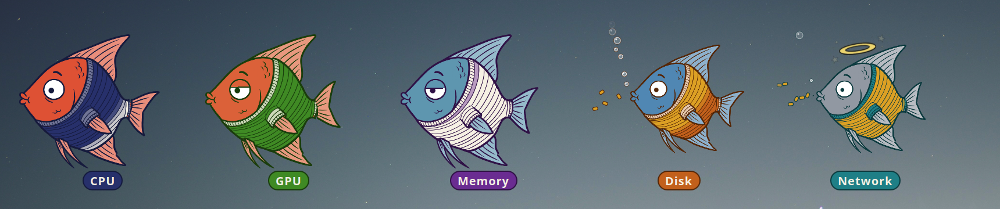

# Angel Aquarium Dream

A dreamlike aquarium wallpaper for KDE Plasma. The angelfish in it wear striped sweaters, and
each one stands for a part of your computer, the way things in a dream stand for something
else. How an angelfish looks and swims says how its part is doing: a busy CPU swims hard in a
full sweater, a hot one turns red, a drive being written to eats, a network that's down falls
asleep on the sand, and real trouble earns a halo, then wings.

Five dream characters swim with them, angelfish that stand for moods rather than hardware:
Dreamy, Anxious, Sleepy, Bling and Angry.

It's meant to be funny as well as glanceable. It isn't a performance graph: precise numbers
belong in other tools (hover over a desktop widget for its figures).

The same angelfish also come as five desktop widgets: CPU, GPU, Memory, Disk and Network
Angelfish.


## Reading an angelfish

Every angelfish follows the same rules, so learning one teaches all of them.

| What you see | What it means |
|---|---|
| Sweater colour | Which part it is: CPU navy, GPU green, memory purple, disk orange, network teal |
| Sweater stripes | How busy or full it is, filling from the collar towards the tail (CPU: one stripe per busy core) |
| Collar | A second gauge: GPU video memory, swap, how full a drive is, how close the network is to its fastest |
| Body colour | Temperature, blue to red (grey when the part has no temperature sensor) |
| Swimming, tail beat, open eyes | Activity right now |
| Eating flakes / blowing bubbles | Data flowing in / out: downloads and uploads, writes and reads |
| Gold stripes | The share of the traffic flowing in |
| Asleep on the sand | Not available, such as a network connection that's down |
| Halo, then wings | Harm to the hardware or to responsiveness: too hot for too long, a card slowing itself down, programs waiting for memory, a connection that was lost. It builds slowly and fades more slowly still |
| Name tag | What the angelfish is, in words |

## The dream characters

They stand for nothing on the computer. Each has a temperament that comes and goes on its own,
acted out in the same visual language as the others. Their sweaters are pale colours instead of
cream, so they're easy to tell from the hardware.

| Name | Sweater | What it does |
|---|---|---|
| Dreamy | pink on mint | drifts slowly, half asleep, trailing a few bubbles; dozes off now and then |
| Anxious | grey on pink | every minute or two a worry builds: it fidgets and works itself up until it overheats and grows a halo, and sometimes wings |
| Sleepy | brown on blue | sleeps on the sand for minutes at a time, dreaming of being an angel: a halo, then wings, until it wakes |
| Bling | rainbow on grey | cruises, then shows off in bursts of flat-out swimming |
| Angry | crimson on yellow | simmers, then flares up: flushes red, swims hard, fumes bubbles, and grows a halo at the height of it, sometimes wings |

The hardware angelfish keep their halos and wings for real trouble, so on a healthy computer
they're rare; the characters show what the angelfish can do.

## Desktop widgets

Each hardware angelfish also comes on its own, as a desktop widget: CPU, GPU, Memory, Disk and
Network Angelfish. Hover over one for its figures.



Settings, per widget: which device (graphics card, drive or network connection), the
temperatures for blue, red and a full halo (CPU, GPU, Memory; the Disk angelfish uses the
drive's own limits), how often to read the sensors (default 2 s), the name tag, and a
background. Like the aquarium, a widget stops moving while a maximised window covers it.

In the store's packages a widget's icon in *Add Widgets* is a standard one (a chip, a monitor…):
Plasma 5 can't take an icon from inside a package. Installed from source (`make install`), they
get their angelfish icons.

## Requirements

- KDE Plasma 6 (the aquarium) or Plasma 5.27 (the aquarium and the widgets). The widgets
  haven't been ported to Plasma 6 yet.
- Plasma's system monitor service, `ksystemstats` (installed with Plasma).
- Optional: `nvidia-smi` for NVIDIA cards (correct video-memory figures, why a card slows itself
  down, and the desktop's own share of the GPU); `ping` for the network angelfish's connection
  check.

## Install

From the KDE Store: right-click the desktop, *Configure Desktop and Wallpaper…*, *Get New
Plugins…*, and search for Angel Aquarium Dream. Plasma 6 and Plasma 5 each have their own
store page ([Plasma 5](https://store.kde.org/p/2379410)). Widgets (Plasma 5): *Add Widgets…*,
*Get New Widgets…*.

From a downloaded package, on Plasma 6:

```sh
kpackagetool6 -t Plasma/Wallpaper -i com.erikzoltan.aquarium-0.2.1-plasma6.zip
```

On Plasma 5:

```sh
kpackagetool5 -t Plasma/Wallpaper -i com.erikzoltan.aquarium-0.2.1.zip
kpackagetool5 -t Plasma/Applet -i com.erikzoltan.cpufish-0.2.0.plasmoid
```

If a Plasma 5 copy of the aquarium is still installed after upgrading to Plasma 6, remove it
first (`rm -r ~/.local/share/plasma/wallpapers/com.erikzoltan.aquarium`): kpackagetool6 can't
replace it.

From source: on Plasma 6, `make install-aquarium6` (it needs `qsb`, from Qt's shader tools,
package qt6-shader-baker on Ubuntu); on Plasma 5, `make install` installs the wallpaper and all
the widgets, with their icons. `make dist6` and `make dist` build the store packages.

Then pick *Angel Aquarium Dream* as the wallpaper type under *Configure Desktop and Wallpaper*.
A newly installed wallpaper sometimes shows only after Plasma restarts
(`systemctl --user restart plasma-plasmashell`, or log out and back in).

## Settings

The aquarium has eight hardware slots: CPU, Memory, GPU 1-2, Disk 1-2 and Network 1-2. Each
can be switched on or off, pointed at a device (graphics card, drive, network connection) and
renamed. Temperatures use each part's own limits, so there's nothing to set. Each of the five
dream characters can be switched on or off and renamed too. The other settings are about cost:

- **Sensor interval** (default 4 s). Readings are about half the cost.
- **Frame rate** (default 20 fps). Each frame redraws the whole screen.
- **Water speed.**

With five hardware angelfish at the defaults, the aquarium takes about 10% of one CPU core and
a few percent of the GPU; the dream characters add about 1% of a core each. It stops while a maximised or full-screen window covers it. With an NVIDIA
card, the settings page shows how much of the GPU the desktop is using, and the GPU angelfish's
tag can show it too, so the wallpaper's own load isn't mistaken for work.

With several screens, one tank spans all of them and the angelfish swim from one to the next.

## Privacy

Everything stays on your computer, with one exception: to tell whether you're online, the
network angelfish pings 1.1.1.1 (Cloudflare) or 8.8.8.8 (Google) every 15 seconds. It sends
nothing else.

## Licence

GPL-2.0-or-later. See `LICENSE`.
